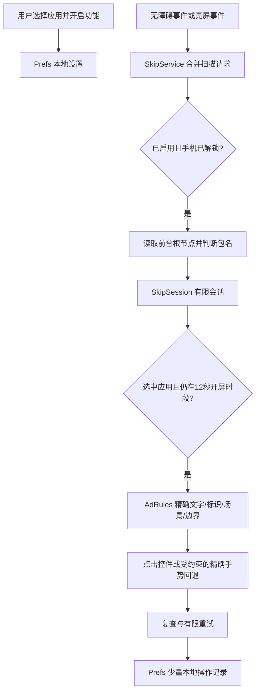

# 架构与数据流

当前范围是所选应用的短暂开屏广告辅助处理，以及广告专用设置的手动引导。应用内持续广告跳过仍是独立研究方向，见[路线图](ROADMAP.md)。

这张图描述的是处理流程，不是无障碍授权范围的隔离承诺。Android 无障碍权限允许读取界面控件和模拟点击；服务会先读取活动窗口根节点及包名，再判断是否为用户所选应用。不能宣传为“权限层面只能看到所选应用”。

## 组件职责

| 组件 | 职责 |
| --- | --- |
| `MainActivity` | 首页、防摇一摇、设置三分区；真实状态、权限说明、应用选择和手动设置引导 |
| `OnboardingPolicy` | 首次安装、旧用户迁移、未完成向导恢复及步骤边界的纯逻辑 |
| `SkipService` | 监听事件、合并扫描、检查屏幕/前台环境、取得节点、提交动作并处理异步回调 |
| `SkipSession` | 与 Android UI 无关的会话状态机、截止时间、动作预算及过期回调隔离 |
| `AdRules` | 与 Android API 无关的文本、精确资源标识、场景及边界判断 |
| `Prefs` | 手机本地的开关、应用选择和少量操作/诊断记录 |

## 从事件到点击

1. 服务收到事件后合并短延迟扫描，避免动画事件持续把扫描推迟。只有功能已启用时才排队处理。
2. 手机非交互或锁屏时不取得活动窗口根节点，必要时重置会话。熄屏会重置；亮屏和解锁只请求检查，不凭这些事件延长已有会话。
3. 获取前台包名后通知会话状态机。随后检查所选应用、排除工具自己，并检查 12 秒处理窗口。页面暂时缺失或同应用事件不能无期限续命。
4. 要求目标应用接近全屏，候选控件可见、启用、包名一致、完全位于窗口和屏幕范围内。深度和节点数量也有上限。
5. 先收集广告或特定开屏场景证据，再用精确规则筛选跳过控件，详见[规则指南](RULES.md)。
6. 首轮尝试控件 `ACTION_CLICK`；B站特定场景可以在相同包名及小范围边界内向父控件回退。必要时才向当前候选控件的中心提交短手势，位置来自这次识别到的控件，而不是固定屏幕坐标。
7. 随后复查原候选，并在预算内进行有限重试。最多两轮处理、最多两次被系统接受的动作；首轮被拒绝的控件调用与受限回退不应被错误描述为所有 Android API 总调用数最多两次。
8. 回调携带会话 epoch / operation token；换应用、锁屏、会话过期或关闭功能后，旧回调不得重新激活处理或重复计数。

“动作被接受”与“广告已经消失”不同。当前计数反映操作提交记录；真实效果需要观察页面是否提前结束。扫描结束后的有限复查也不能代替对所有广告素材的实机验证。

## 首次设置与 Activity 生命周期

五步向导依次介绍用途和权限、选择应用、本人开启无障碍、核对防摇一摇/后台设置、检查实际状态。每步可稍后设置；完成向导不会自动授权或开启功能。

持久化键为 `onboarding_seen`、`setup_in_progress`、`setup_step`。已有 `enabled`、`apps`、`count` 或 `last_time` 的旧用户不被强制重新引导；进行中的向导优先恢复，因此选择应用后不会被误当作旧用户跳出。用户可在设置中主动重开向导。

`onResume` 仅更新当前状态，不重新生成整页。页签、折叠与滚动位置保留在 Activity 状态中；引导步骤还保存在本地偏好中，支持流程中返回系统设置。更新 UI 时不要退回每次 `onResume` 直接重建页面的做法。

## 防摇一摇的准确含义

本工具提供应用内广告专用设置的指引。已核对的B站 9.15.0 路径是“我的 → 设置 → 隐私权限设置 → 允许广告访问传感器：关闭”；状态由B站保存，工具不能把阅读指引当作已关闭。

没有全局关闭加速度计或设备方向感应，不使用 VPN、Root 或系统权限劫持。正常旋转和体感所需的整体权限保持原样；自动跳过只是尽早结束广告，广告结束前仍可能触发跳转。不能声称所有应用的晃动跳转都已被阻断。

## 隐私与信任边界

App 没有 `INTERNET` 权限，识别在本机进行，不上传界面、所选应用或设备信息；不请求设备唯一标识。控件文字在识别过程中被临时读取，不能笼统写“从不读取用户内容”。

本地保存 `enabled`、`apps`、计数 `count`、最近应用/按钮 `last`、时间 `last_time`、少量 `diagnostic` 及引导状态。清除操作记录时移除 `count`、`last`、`last_time`、`diagnostic` 和兼容性诊断时间键 `last_diag_time`，保留功能选择及引导状态。当前服务只写 `diagnostic`，并未持久化该兼容时间键。

网站、GitHub 反馈和打赏由系统浏览器及相应平台处理，属于另一个联网边界。给 App 增加统计、远程规则、网络 SDK 或新敏感权限均须作为独立设计变更说明，不得悄然加入。
